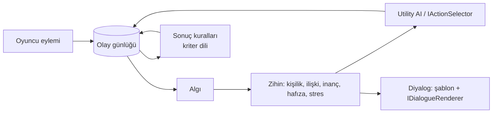

# Yankı

[](https://github.com/yusufoztoprak495-star/yanki/actions/workflows/ci.yml)
[](LICENSE)
[](docs/adr/0004-hedef-framework.md)


**Oyuncunun her kararı NPC'lerde ve dünyada yankılanır — ve motor bunun _nedenini_ kanıtlayabilir.**

Yankı, oyun motorundan bağımsız, açık kaynak bir C# NPC ve sonuç motoru. NPC'ler kişiliklerine sadık kalarak kural ve
utility AI ile karar verir; ne gördüklerini, kimden ne duyduklarını hatırlar; oyuncunun ne yaptığı kadar **ne zaman**
ve **hangi sırayla** yaptığı da hikâyeyi değiştirir. Her olay nedeniyle birlikte kaydedilir, böylece "bu NPC neden
bana kızgın?" sorusunun cevabı bir zincir olarak okunabilir.

> 🚧 **Erken geliştirme aşamasında.** 12 haftalık planın 1. haftası: iskelet, CI ve mimari kararlar.
> Tarayıcıda oynanabilir demo 10. haftada gelecek.

## Neden?

Çoğu oyunda seçimler sahtedir: hikâye tek çizgide akar, seçenekler sadece renk değiştirir. Yankı'nın hedefi şunlar:

- **Gerçek sonuçlar:** Bir şüpheliye yanlış şey söylemek, olayı yanlış çözmene yol açabilir.
- **Tutarlı karakterler:** Açgözlü bir NPC tek bir iyilikle cömertleşmez. Kişiliğine aykırı davranabilir ama bu ona stres olarak döner.
- **Ölçülebilir farklılık:** Tek bir seçimi değiştirip iki gidişatı yan yana karşılaştıran bir replay raporu.
- **Deterministik:** Aynı seed + aynı girdiler = birebir aynı simülasyon. Hatalar tekrar üretilebilir.

## Benzerlerinden farkı

| | Yankı | Love/Hate | Araştırma motorları (Versu, Talk of the Town) |
|---|---|---|---|
| Açık kaynak | ✅ MIT | ❌ Ücretli | Kısmen |
| Motordan bağımsız | ✅ .NET Standard 2.1 | ❌ Yalnızca Unity | ❌ JS/Python araştırma kodu |
| Deterministik replay | ✅ | ❌ | ❌ |
| İnancın kaynağı ("kimden duydu?") | ✅ Kanıt listesi | ❌ | ✅ (Talk of the Town) |
| Nedensellik zinciri | ✅ Her olayda `KuralId` + neden | ❌ | Kısmen |

## Mimari (özet)



Ayrıntılar: [`docs/architecture.md`](docs/architecture.md) ve karar kayıtları [`docs/adr/`](docs/adr/).

## Repo yapısı

```
src/
  Yanki.Core/        olay kaydı, dünya, zihin, algı, karar, kurallar (dış bağımlılık yok)
  Yanki.Dialogue/    şablon ve gramer, IDialogueRenderer
  Yanki.Cli/         konsol sandbox ve araçlar (yanki)
tests/
  Yanki.Core.Tests/        birim ve mimari testleri
  Yanki.Scenarios.Tests/   golden replay ve senaryo testleri
samples/KasabaHani/  demo senaryosu
docs/                mimari, ADR'ler, notlar, devlog
```

## Hızlı başlangıç

Gereksinim: [.NET 10 SDK](https://dotnet.microsoft.com/download).

```bash
git clone https://github.com/yusufoztoprak495-star/yanki
cd yanki
dotnet build
dotnet test
dotnet run --project src/Yanki.Cli -- --version
```

## Yol haritası

| Hafta | Odak | Durum |
|---|---|---|
| 1 | Kurulum, iskelet, CI, ADR'ler | 🔄 |
| 2 | Olay kaydı, dünya, kriter dili | ⏳ |
| 3 | Zihin ve doğrudan algı | ⏳ |
| 4 | Sonuç kuralları ve ince dikey dilim | ⏳ |
| 5 | Utility AI | ⏳ |
| 6 | Dedikodu ve stres | ⏳ |
| 7 | Frenler ve sağlamlık | ⏳ |
| 8 | Diyalog | ⏳ |
| 9 | Demo içeriği (Kasaba Hanı) | ⏳ |
| 10 | Tarayıcı demosu (Blazor WASM) | ⏳ |
| 11 | Ölçüm ve denge | ⏳ |
| 12 | Cila ve v0.1.0 yayını | ⏳ |

## Bu proje nasıl geliştirildi

Tasarım kararları ve sistem kurgusu bana (Yusuf) ait; kodun büyük kısmı AI kod araçlarıyla yazıldı ve her adımı
inceleyip anladım. Ayrıntılı iş bölümü: [`docs/ai-usage.md`](docs/ai-usage.md).

## Lisans

[MIT](LICENSE)
