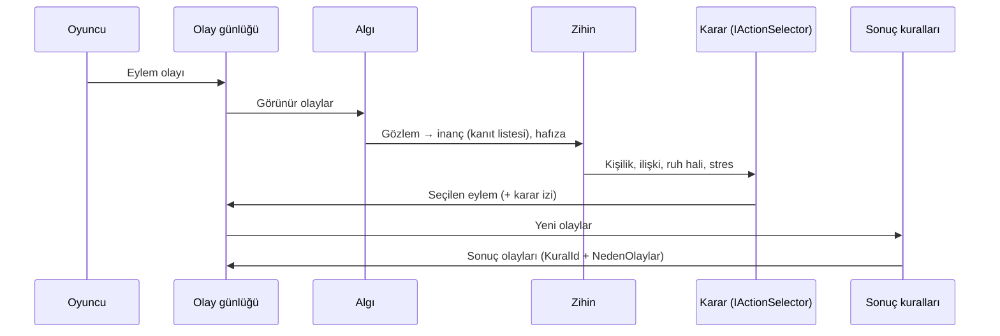

# Mimari

> Taslak. Modüller eklendikçe her bölüm doldurulacak.

## Tick döngüsü (hedef)

## Modüller (`Yanki.Core`)

| Modül | Sorumluluk | Hafta |
|---|---|---|
| Events | Olay tipleri, günlük, durum hash'i | 2 |
| World | Gerçekler, mekan grafiği, anahtarlı RNG | 2 |
| Criteria | Kriter dili ayrıştırıcı ve puanlayıcı | 2 |
| Mind | Kişilik, 3 eksenli ilişki + fikir modifier'ları, ruh hali, hafıza, inançlar, stres | 3, 6 |
| Perception | Görünürlük, doğrudan algı, dedikodu ile aktarım | 3, 6 |
| Rules | Sonuç kuralları, frenler, korumalı bayraklar | 4, 7 |
| Decision | `IActionSelector`, `UtilitySelector`, karar izi | 5 |
| Simulation | Tick döngüsü, kayıt/yükleme | 4, 7 |

## Değişmezler

- Determinizm: aynı seed + aynı girdi = aynı durum hash'i.
- Her olay nedenini taşır.
- Çekirdek dış pakete, ağa, dosya sistemine bağımlı değildir.

Kararların gerekçeleri: [`adr/`](adr/).
