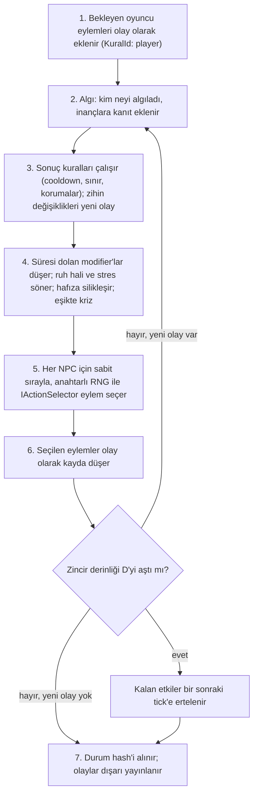

# Mimari

> Taslak. Modüller eklendikçe her bölüm doldurulacak (plan bölüm 5 ve 6).

## Modüller

Motor sekiz modülden ve bunların ortak kullandığı kriter dilinden oluşur. Modüller yalnızca tanımlı arayüzlerle konuşur.

| Modül | Klasör | Sorumluluk | Hafta |
|---|---|---|---|
| Olay Kaydı | `Events` | Değişmez günlük, nedensellik (`NedenOlaylar`, `KuralId`), durum hash'i | 2 |
| Dünya | `World` | NPC'ler, mekan grafiği, eşyalar, gerçekler, korumalı varlıklar, anahtarlı RNG | 2 |
| Algı | `Perception` | Görünürlük, doğrudan algı, dedikodu, top-n konu sınırı | 3, 6 |
| Zihin | `Mind` | Kişilik, ilişki, fikir modifier'ları, ruh hali, stres, hafıza, inançlar | 3, 6 |
| Sonuç Kuralları | `Rules` | `ne_zaman <olay> + kriterler → etkiler` | 4, 7 |
| Karar | `Decision` | `IActionSelector`, `UtilitySelector`, karar izi | 5 |
| Frenler | `Brakes` | Cooldown, tetiklenme ve zincir sınırı, korumalı bayraklar, yay değişkenleri | 7 |
| Simülasyon / Dış API | `Simulation` | Tick döngüsü, `Submit`, `Tick`, sorgular, kayıt/yükleme | 4, 7 |
| Kriter dili (ortak) | `Criteria` | Ağırlıklı kriterler: sonuç kuralları, diyalog, eylem ön koşulları | 2 |

Diyalog (`Yanki.Dialogue`) ayrı bir pakettir: şablon seçimi, mini gramer, `IDialogueRenderer` (8. hafta).

## Tick döngüsü

## Değişmezler

- Determinizm: aynı seed + aynı girdi = aynı durum hash'i.
- Her olay nedenini taşır (`NedenOlaylar`, `KuralId`).
- Çekirdek dış pakete, ağa, dosya sistemine bağımlı değildir.

Kararların gerekçeleri: [`adr/`](adr/).
